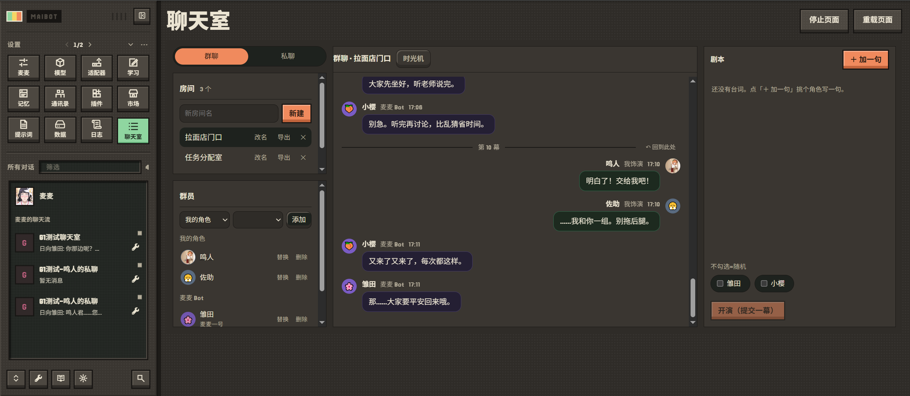
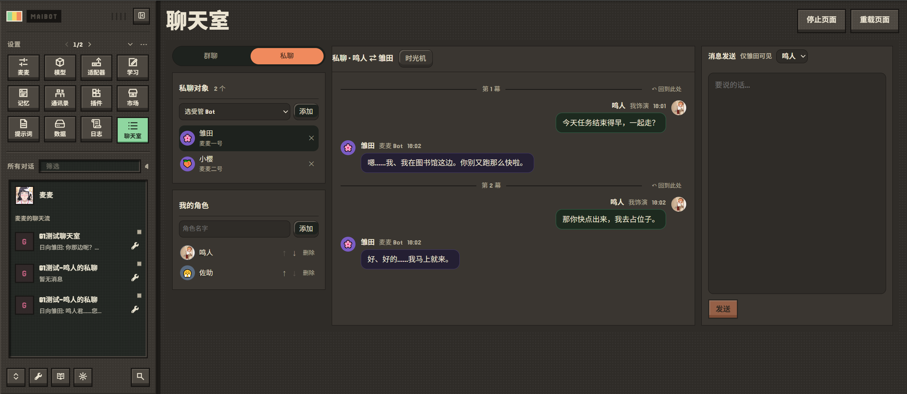

# 麦麦聊天室（壳阶段）

> 给 [MaiBot](https://github.com/Mai-with-u/MaiBot) 做的 WebUI 聊天室插件 —— **壳阶段**。
> 让多个不同人格的麦麦 Bot 加上你自己演的多个角色，同台一个剧本房间，共用一条时间线。

- **版本**：v0.1.0（壳阶段）
- **插件 ID**：`maichat.scriptroom`
- **兼容**：MaiBot 1.4.4 ~ 1.4.99，plugin-sdk 2.20+
- **协议**：MIT

---

## ⚠️ 这是壳阶段：全部是假数据

**页面上的一切都是 Mock。** 没有真实 Bot 参与，没有真实收发，没有调度、存档、记忆或重演。

| 明确**没有**做 | 说明 |
| --- | --- |
| maim 网关递话 / 收话 | 不发任何真实消息 |
| 真实调度 | 接话顺序是假造的 |
| SQLite 存档 | 房间与时间线只存在于插件内存，**插件重载即回初始状态** |
| 剧本重演 | 只有 UI 演示，没有真实的重演逻辑 |
| 接入校验 | 「可接入 / 未运行」是写死的假状态 |
| 读写 Bot 数据 | 不碰 `MaiBot.db`、记忆库，不写 `bot_config.toml` |

这一阶段的目的是**把界面和节奏做出来给人看**，顺便熟悉未来的真实时延。

---

## 截图

**群聊视图**



**私聊视图**



---

## 一、它能做什么

| 板块 | 说明 |
| --- | --- |
| **房间管理** | 列表 / 新建（置顶）/ 改名 / 删除 / 切换；成员是**房间级配置** |
| **群员** | 分「我的角色」与「麦麦 Bot」两组；可添加 / 移除 / 替换 |
| **我的角色** | 全局一份、有顺序；可新建 / 换头像 / 改名 / 调位置 / 删除 |
| **私聊对象** | 从宿主的受管 Bot 里挑；可增删 |
| **群聊时间线** | 按「段」划分；**Bot 靠左、我方靠右**；段分隔线带「↶ 回到此处」 |
| **剧本框** | 结构化行编辑器：每行 = 角色下拉 + 台词 + ↑↓ 调顺序；行序即发言顺序 |
| **接话对象** | 只列本房间的 Bot，**不勾选 = 随机** |
| **私聊** | 独立入口与独立窗口；按「对方 Bot × 我方角色」分开显示记录 |
| **月光宝盒** | 段上的「回到此处」→ 确认气泡 → 该段及之后灰显标「已作废」 |
| **时光机** | 输入时间跨度和剧情 → 生成一段「剧情旁白」的剧情段 |

### 几个设计上的选择

**剧本行的顺序是有意义的。** 它决定 Bot 读到台词的先后，等同真实群聊里群友发言的先后。
调完的顺序会原样进 `lines` 数组、再原样进时间线 —— 下一阶段接真通道时不用改管道。

**「我的角色」是上游，房间群员是下游。** 下游只列上游已有的角色，下游不会出现上游没有的选项。

**平台身份固定。** 每个角色绑定固定的「平台 + 账号」，`platform` 一律是 `webui`
（自定义平台名会被宿主的适配器名单拦掉，聊天运行实例根本建不起来）。
**假数据即真格式**，下一阶段接真通道时不用再改。

**头像走 data URI，不落盘。** 页面把图缩到 128×128、变成 data URI 传给插件，
存在插件内存里，**一个字节都不写磁盘**。本插件不申请宿主的图片上传能力
（`capabilities` 是空的），因此宿主的上传通道对本插件完全关闭。
头像只在内存里、插件重载回 emoji —— 这与房间/时间线的纯内存语义一致。

---

## 二、安装

1. 把本仓库的文件放到 MaiBot 的 `plugins/` 目录下：

   ```
   MaiBot/
   └── plugins/
       └── maichat_scriptroom/
           ├── _manifest.json
           ├── config.toml
           ├── plugin.py
           ├── webui.json
           ├── assets/
           │   └── icon.png
           └── webui/
               └── index.html
   ```

2. 启动（或重启）MaiBot。

3. 打开 WebUI，侧栏「插件」区会出现「聊天室」入口；或直接访问
   `http://127.0.0.1:8001/extensions/maichat.scriptroom/studio`。

**更新**：覆盖 `plugins/maichat_scriptroom/` 里的文件，然后
`/pm plugin reload maichat.scriptroom`（或重启 MaiBot）。
只改了 `webui/index.html` 的话，点页面右上角的「重载页面」就够了。

**卸载**：删掉 `plugins/maichat_scriptroom/` 整个目录，再 `/pm plugin reload maichat.scriptroom`。

---

## 三、目录结构

```
maichat_scriptroom/
├── _manifest.json      插件清单（manifest_version 2，capabilities: []）
├── config.toml         仅 [plugin] enabled = true
├── plugin.py           假数据 + 18 个静态 API（单文件，无兄弟模块）
├── webui.json          WebUI 页面声明（schema_version 2，mode: custom）
├── assets/
│   └── icon.png        插件图标
├── webui/
│   └── index.html      页面本体（单文件，CSS/JS 全内联）
└── docs/
    └── images/         README 用到的截图
```

---

## 四、边界

这个插件**只做壳，不做肉**，并且严格守着这几条：

- **不改宿主源码** —— 只新增文件，不动 MaiBot 任何既有 `.py`。
- **不装消息处理类插件** —— `capabilities` 为空，不注册 Tool / Command / Hook / EventHandler / Gateway。
- **不使用自定义平台名** —— 涉及 platform 的地方一律是 `webui`。
- **不碰 Bot 数据** —— 不读写真实数据库，不写 `bot_config.toml`；所有状态只在内存里。
- **单文件插件** —— `plugin.py` 没有兄弟模块，避开「宿主按路径加载、sys.path 不含插件目录」的裸 import 陷阱。

---

## 五、下一阶段

壳已经封板，下一步是「填肉」：把 `plugin.py` 里的假数据源换成
「maim 网关递话 + WebUI 历史接口收话」，**页面 `webui/index.html` 不用改** ——
现在的 `shell_submit_beat` 返回的是一份调度计划（顺序 / 每人的等待秒数 / 每人的消息行），
真实实现返回同样形状的东西，页面侧就能直接演。

还需要做的：真实接入校验（registry 名单层 + maim 网关 `api_key` 握手层 + 心跳）、
SQLite 存档、L1 重演、真实私聊递话。

---

## 相关

- [MaiBot](https://github.com/Mai-with-u/MaiBot) —— 本插件的宿主
- [麦麦敲门 MaiKnock](https://github.com/NewB2001/maiknock) —— 同一个系列
- [麦麦多平台 TTS 语音](https://github.com/NewB2001/maimai-tts-plugin) —— 同一个系列

## 致谢

界面上的每个坑都是实测踩出来的：横向滚动条、破头像、「回到此处」的二次确认……
都留在了本仓库的提交历史里。

## 协议

MIT，见 [LICENSE](LICENSE)。
